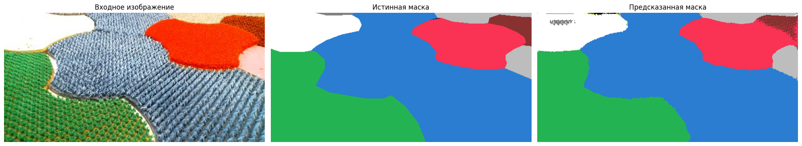
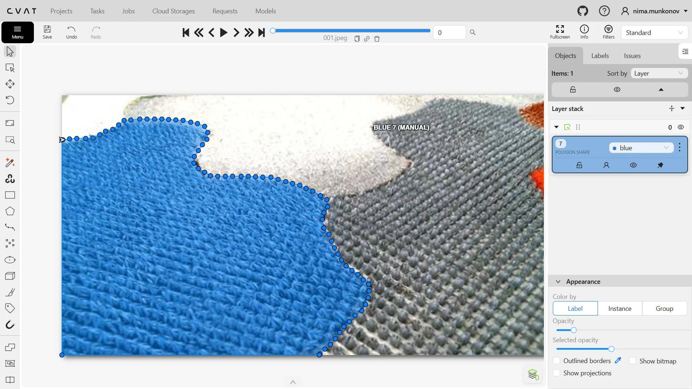
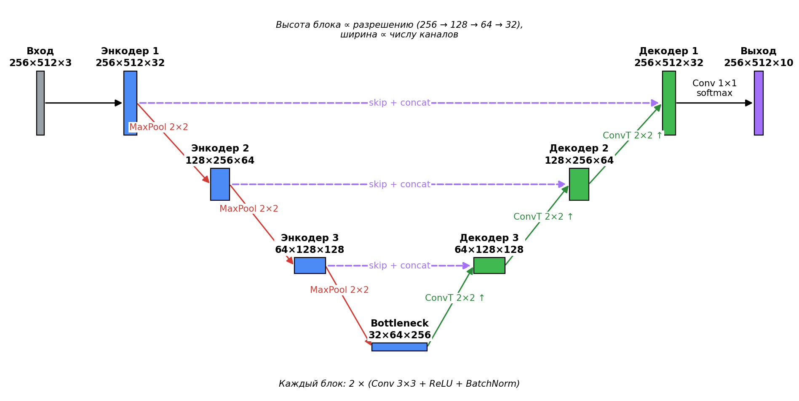
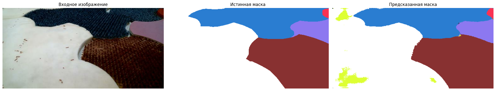
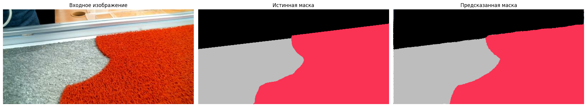
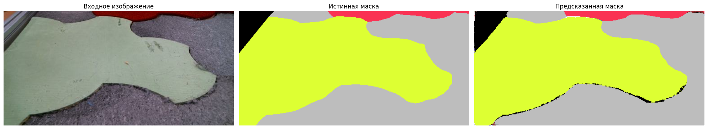

# Семантическая сегментация подстилающих поверхностей для мобильного робота

Модель **U-Net** (TensorFlow / Keras), которая попиксельно классифицирует поверхности на испытательном полигоне мобильного робота Festo Robotino по кадрам с бортовой камеры.

> Лабораторная работа №2 «Применение методов семантической сегментации в задачах технического зрения» по дисциплине «Машинное обучение в робототехнике». НИ ТПУ, Инженерная школа информационных технологий и робототехники, направление 15.03.06 «Мехатроника и робототехника».

Пример работы на тестовой выборке (модель её не видела): входное изображение, истинная маска, предсказание модели.



## Содержание

1. [О проекте](#о-проекте)
2. [Данные](#данные)
3. [Предобработка](#предобработка)
4. [Архитектура модели](#архитектура-модели)
5. [Компиляция модели](#компиляция-модели)
6. [Обучение](#обучение)
7. [Результаты](#результаты)
8. [Принятые решения](#принятые-решения)
9. [Выводы и возможные улучшения](#выводы-и-возможные-улучшения)
10. [Структура репозитория](#структура-репозитория)
11. [Запуск](#запуск)

## О проекте

**Цель** — разработать и обучить модель машинного обучения для семантической сегментации (пиксельной классификации), которая выделяет различные участки подстилающих поверхностей в навигационном поле мобильного робота.

Практический смысл: чтобы планировать движение, роботу нужно знать, какая поверхность находится перед ним. Модель получает RGB-кадр и возвращает маску того же размера, где каждому пикселю присвоен один из 10 классов (9 типов поверхностей + фон).

Задание состояло из трёх частей:

1. собрать данные на испытательном полигоне;
2. подготовить данные для обучения;
3. выполнить работу с моделью машинного обучения: построить, обучить и протестировать её.

## Данные

### Сбор

Данные собраны на испытательном полигоне для робота Festo Robotino камерой, закреплённой на самом роботе. Получен видеоряд с изображением полигона при разных положениях робота.

### Подготовка

1. Видеоряд разбит на отдельные кадры, часть кадров пропущена (соседние кадры почти идентичны).
2. С помощью вспомогательных скриптов (см. [`data_preparation/`](data_preparation)) разрешение уменьшено с 1080×1920 до **256×512** пикселей, формат RGB. Всего получено 146 изображений.
3. Разметка выполнена в инструменте **CVAT** полигональной разметкой контуров. Для каждого изображения созданы маски, где каждый класс поверхности закрашен своим цветом; на задний план помещён фоновый слой (чёрный цвет).
4. Разметка выгружена в JSON (формат COCO) и преобразована в PNG-маски скриптом.
5. Часть масок оказалась размечена неправильно — их удалили вместе с соответствующими изображениями. Итог: **126 пар «изображение — маска» 256×512 RGB** (папка [`dataset/`](dataset)).

Пример разметки в CVAT: контур области класса `blue` обведён полигоном.



### Классы и цвета масок

| ID | Класс | RGB |
|---|---|---|
| 0 | background (фон) | (0, 0, 0) |
| 1 | blue | (42, 125, 209) |
| 2 | green | (36, 179, 83) |
| 3 | light_green | (221, 255, 51) |
| 4 | dark_red | (136, 49, 49) |
| 5 | red | (250, 50, 83) |
| 6 | dark_gray | (129, 129, 129) |
| 7 | gray | (189, 189, 189) |
| 8 | white | (255, 255, 255) |
| 9 | purple | (140, 120, 240) |

Цвета классов совпадают с цветами меток в CVAT.

## Предобработка

### Проблема размытия масок

Если маски сжимаются или масштабируются с интерполяцией, на границах классов появляются пиксели с «промежуточными» цветами, которых нет среди классов. Проблема решена уже на этапе подготовки: JSON-разметка из CVAT преобразуется в PNG скриптом [`visualize_annotations.py`](data_preparation/visualize_annotations.py), который закрашивает каждую область строго цветом её класса. Дополнительно в ноутбуке каждый пиксель маски сопоставляется с ближайшим цветом из таблицы классов (евклидово расстояние в RGB), поэтому даже при остаточных артефактах получается корректная карта классов.

### Загрузка данных

Изображения и маски загружаются через `tf.keras.utils.image_dataset_from_directory`. Для масок задан параметр `interpolation='nearest'`: при ресайзе билинейной интерполяцией (значение по умолчанию) между пикселями разных классов возникают значения, которых нет в наборе классов. Nearest-neighbor берёт ближайший пиксель без смешивания и сохраняет чёткие границы.

### Нормализация и one-hot кодирование

- Изображения нормализуются из диапазона [0, 255] в [0, 1] делением на 255.
- RGB-маска переводится в одноканальную маску меток классов (0–9), а затем в one-hot тензор формы `(H, W, 10)`: по последней оси единица стоит в позиции своего класса.

One-hot формат нужен для функции потерь `categorical_crossentropy`, выходного слоя с softmax (10 каналов) и метрики `OneHotIoU` из Keras. Альтернатива — хранить маски одноканальными с `class_id` и использовать `sparse_categorical_crossentropy`: результат обучения идентичен, но one-hot формат позволяет использовать `OneHotIoU`.

### Разделение на выборки

| Выборка | Размер | Назначение |
|---|---|---|
| Обучающая (train) | 76 изображений (60%), 19 батчей | Подстройка весов модели |
| Валидационная (val) | 24 изображения (20%), 6 батчей | Контроль переобучения после каждой эпохи |
| Тестовая (test) | 28 изображений (20%), 7 батчей | Финальная оценка качества модели |

Обоснование пропорции 60/20/20: при малом датасете (126 изображений) важно выделить достаточно данных для валидации и тестирования, чтобы оценка была статистически значимой. Для большого датасета (>10 000 изображений) можно было бы взять 80/10/10. Обучающая выборка перемешивается (`shuffle`), чтобы избежать систематического смещения.

### Оптимизация конвейера данных

Применён `.prefetch(AUTOTUNE)`: TensorFlow заранее готовит следующий батч в буферной памяти, пока GPU обрабатывает текущий. Это сокращает простои GPU и ускоряет обучение.

## Архитектура модели

### Подходы к детектированию поверхностей

- **Классические методы** компьютерного зрения (пороговая бинаризация в HSV/LAB, K-means кластеризация, детекторы границ Canny/Sobel) очень дёшевы и работают в реальном времени, но плохо обобщаются: не учитывают сложные текстуры, смену освещения, тени и разнообразие форм.
- **Свёрточные нейронные сети (CNN)** автоматически извлекают иерархические признаки из данных и обучаются на размеченных наборах, поэтому обычно сегментируют заметно точнее.

Выбор CNN обоснован тем, что на полигоне есть поверхности со сложными текстурами и формами, а также тени и блики. В отчёте классические методы не запускались и количественно не сравнивались; выбор сделан на основе их известных ограничений.

### U-Net

Выбрана архитектура **U-Net** — автоэнкодер с пропускными соединениями (skip-connections). Реализация — функция `build_unet` в [`lb2.ipynb`](lb2.ipynb).

Схема сети. Высота блока пропорциональна пространственному разрешению (256 → 128 → 64 → 32), ширина — числу каналов; подписи — размеры тензоров высота×ширина×каналы. Пунктиром показаны skip-connections с конкатенацией. Внутри каждого блока энкодера и декодера две свёртки 3×3 с ReLU и BatchNorm.



**Энкодер (путь сжатия).** Три блока «Conv 3×3 → BatchNorm → Conv 3×3 → BatchNorm → MaxPool 2×2». Пространственное разрешение уменьшается по высоте 256 → 128 → 64 → 32, число каналов растёт 3 → 32 → 64 → 128. Энкодер отвечает на вопрос «что на изображении?».

**Bottleneck (латентное представление).** Два свёрточных слоя с 256 фильтрами; выход 32×64×256 — компактное описание признаков изображения.

**Декодер (путь восстановления).** Три блока «Conv2DTranspose (stride 2) → конкатенация со skip-connection → две свёртки с BatchNorm»; каналы 128 → 64 → 32. Декодер восстанавливает исходное разрешение и отвечает на вопрос «где именно расположены объекты?».

**Skip-connections.** Карты признаков с каждого уровня энкодера передаются на соответствующий уровень декодера и объединяются с ним по каналам. Декодер получает и высокоуровневую семантику из bottleneck, и детальную пространственную информацию (текстуры, границы) из ранних слоёв.

**Выходной слой.** `Conv2D` с 10 фильтрами (по числу классов), ядро 1×1, активация softmax. Для каждого пикселя получается 10 чисел от 0 до 1 с суммой 1; класс определяется через `argmax`.

### Почему именно так

- **U-Net, а не простой автоэнкодер.** При многократном пулинге базовый автоэнкодер теряет мелкие детали и точное положение границ — граница на выходной маске получается размытой. Skip-connections решают эту проблему.
- **Конкатенация (стиль DenseNet), а не сложение (стиль ResNet).** При сложении тензоры суммируются поэлементно и информация смешивается. При конкатенации они объединяются по каналам, вся информация сохраняется, и сеть получает больше признаков. Это стандарт для U-Net и лучше подходит для сегментации, где важны точные границы.
- **BatchNormalization после каждой свёртки.** Нормализует активации к нулевому среднему и единичной дисперсии, стабилизирует обучение, допускает более высокий learning rate и слегка регуляризует. Без неё обучение на маленьком датасете было бы менее стабильным.

## Компиляция модели

| Параметр | Значение и обоснование |
|---|---|
| Оптимизатор | Adam, lr = 1e-4 — адаптивный learning rate, сочетает AdaGrad и RMSProp |
| Функция потерь | `categorical_crossentropy` — стандарт для многоклассовой классификации в one-hot формате |
| Метрика 1 | `OneHotIoU` (имя `OHIoU`) — основная метрика сегментации |
| Метрика 2 | `accuracy` — доля правильно классифицированных пикселей |

- **Adam, lr = 1e-4.** Adam подбирает learning rate для каждого параметра (β₁ = 0.9, β₂ = 0.999). Значение 1e-4 консервативно и предотвращает нестабильность. При 1e-3 на маленьком датасете возможны скачки loss и неустойчивая сходимость; при 1e-5 обучение слишком медленное.
- **`categorical_crossentropy`.** Маски в one-hot формате (10 каналов); функция тем сильнее штрафует модель, чем увереннее она ошибается. Альтернатива — Dice Loss, лучше работающая на несбалансированных данных, но кросс-энтропия стандартнее и рекомендована в методических указаниях.
- **IoU вместо accuracy.** Если фон занимает 80% кадра, модель может назвать всё фоном и получить 80% accuracy. IoU = площадь пересечения / площадь объединения предсказанной и истинной областей класса и такому «обману» не поддаётся.
- **Фон (id = 0) исключён из IoU** (`target_class_ids = 1…9`), чтобы доминирующий класс не завышал метрику.

## Обучение

### Параметры

| Параметр | Значение |
|---|---|
| Количество эпох | 50 |
| Размер батча | 4 |
| Обучающих / валидационных батчей | 19 / 6 |
| Чекпоинт | сохранение лучшей модели по `val_OHIoU` (`mode='max'`, `save_best_only=True`) |

- **batch_size = 4.** При 76 обучающих изображениях 256×512×3 такой батч занимает разумный объём GPU-памяти. Больший батч (8, 16) может не поместиться; меньший (1–2) даёт шумные градиенты и нестабильное обучение.
- **50 эпох** достаточно для сходимости на таком объёме данных. Лучший `val_OHIoU` = 0.925 достигнут на 41-й эпохе; чекпоинт автоматически сохраняет лучшую модель, поэтому дополнительные эпохи результат не ухудшают.

### Контроль переобучения

Переобучение — подстройка весов под обучающую выборку, приводящая к снижению обобщающей способности. Признаки:

| Параметр | Нормальное обучение | Переобучение |
|---|---|---|
| Точность (train) | растёт | растёт |
| Потери (train) | падают | падают |
| Точность (val) | растёт | **падает** |
| Потери (val) | падают | **растут** |

Использованные меры: (1) отдельная валидационная выборка; (2) `ModelCheckpoint` с `save_best_only=True`; (3) BatchNormalization с лёгким регуляризующим эффектом. Не использованы, но возможны: Dropout, аугментация данных (повороты, отражения, яркость), EarlyStopping по `val_loss`. Достигнутый `val_OHIoU` = 0.925 говорит о хорошем обобщении и без дополнительной регуляризации.

### Динамика обучения

| Эпоха | train OHIoU / loss | val OHIoU / val_loss |
|---|---|---|
| 1 | 0.118 / 2.471 | 0.028 / 2.281 |
| 10 | 0.685 / 0.674 | 0.098 / 2.032 |
| 20 | 0.793 / 0.455 | 0.358 / 1.268 |
| 30 | 0.870 / 0.286 | 0.662 / 0.616 |
| 38 | 0.898 / 0.224 | 0.899 / 0.172 |
| 41 (лучшая) | 0.909 / 0.206 | 0.925 / 0.167 |
| 50 | 0.928 / 0.170 | 0.908 / 0.168 |


После 41-й эпохи `val_OHIoU` колеблется (0.848–0.919) — это начальные признаки переобучения. Чекпоинт при этом сохранил лучшую модель.

## Результаты

### Метрики на тестовой выборке

Оценка на 28 тестовых изображениях, которые модель не видела при обучении:

| Метрика | Значение |
|---|---|
| OneHotIoU (без фона) | 0.9110 (91.1%) |
| Accuracy | 0.9507 (95.1%) |
| Loss | 0.1661 |

IoU = 91.1% означает, что предсказанные области классов совпадают с истинными на 91.1%. Accuracy = 95.1% — 95 из 100 пикселей классифицированы правильно.

> Примечание: в ноутбуке `model.evaluate` вызывается на модели сразу после обучения, то есть с весами последней (50-й) эпохи, а не лучшего чекпоинта. Лучший чекпоинт (`val_OHIoU` = 0.925) сохранён отдельно в `models/segmentation/`.

### Визуальный анализ

Предсказания на тестовых изображениях показывают, что модель корректно выделяет основные области поверхностей, включая сложные границы между классами. Небольшие ошибки видны на границах близких по цвету классов, например `gray` и `dark_gray`, а также на мелких участках у края кадра.





## Принятые решения

| Решение | Альтернатива и причина отказа |
|---|---|
| U-Net (skip-connections) | Простой автоэнкодер — теряет пространственную информацию, размытые границы |
| Конкатенация skip-connections | Сложение (ResNet-style) — смешивает информацию, менее точные границы |
| `categorical_crossentropy` | Dice Loss — лучше для несбалансированных данных, но кросс-энтропия стандартнее |
| Adam, lr = 1e-4 | SGD — нужна ручная настройка lr schedule; lr = 1e-3 — нестабильно на малом датасете |
| BatchNormalization | Dropout — менее стабилен для свёрточных сетей сегментации |
| `interpolation='nearest'` для масок | Билинейная — создаёт промежуточные цвета между классами |
| One-hot формат масок | Sparse формат — эквивалентен, но несовместим с `OneHotIoU` |
| IoU без фона | IoU с фоном — завышает метрику за счёт доминирующего класса |
| CNN (глубокое обучение) | Классические методы (HSV, K-means, Canny) — низкая обобщающая способность |

## Выводы и возможные улучшения

В ходе работы разработана и обучена модель семантической сегментации на базе U-Net для детектирования подстилающих поверхностей в навигационном поле мобильного робота.

1. Собрано и размечено 126 изображений с 10 классами (9 поверхностей + фон).
2. Реализована предобработка масок с сопоставлением ближайшего цвета (nearest-color matching) для устранения артефактов сжатия.
3. Построена U-Net с тремя уровнями энкодера/декодера, skip-connections и BatchNormalization.
4. Достигнуто качество сегментации IoU = 91.1% на тестовой выборке.

Возможные улучшения:

1. **Аугментация данных:** случайные повороты, отражения, изменения яркости и контраста — увеличивают эффективный размер датасета.
2. **Transfer learning:** предобученный энкодер (ResNet, MobileNet с весами ImageNet) для лучшего обобщения.
3. **Увеличение датасета:** дополнительные данные при разных условиях освещения.
4. Dice / focal loss и EarlyStopping для борьбы с дисбалансом классов и переобучением.

Ограничения: небольшой датасет (126 изображений) с одного полигона; устойчивость к другому освещению и другим поверхностям не проверялась.

## Структура репозитория

```
.
├── lb2.ipynb                  # основной ноутбук: данные, модель, обучение, оценка
├── dataset/
│   ├── image/                 # 126 изображений 256×512
│   └── mask/                  # 126 цветных масок
├── data_preparation/          # скрипты подготовки данных
│   ├── select_images.py       # выбор каждого N-го кадра и переименование
│   ├── remove_duplicates.py   # удаление дубликатов по SHA-256
│   ├── squeeze_images.py      # ресайз до 512×256
│   ├── visualize_annotations.py  # COCO JSON (CVAT) → цветные PNG-маски
│   └── instances_default.json # экспорт разметки из CVAT
├── docs/                      # примеры предсказаний для README
└── models/segmentation/       # веса (.keras) и график обучения
```

## Запуск

Нужен Python 3.10+.

```bash
pip install tensorflow numpy opencv-python pillow matplotlib pyyaml
```

Для скриптов подготовки данных дополнительно:

```bash
pip install pycocotools send2trash
```

Обучение и оценка: откройте `lb2.ipynb` и выполните ячейки по порядку (пути к `dataset/` относительные, запускать из корня проекта).

Скрипты подготовки данных:

```bash
python data_preparation/select_images.py --help
python data_preparation/remove_duplicates.py --help
python data_preparation/squeeze_images.py <входная_папка> <выходная_папка>
cd data_preparation && python visualize_annotations.py   # нужен instances_default.json рядом
```

Загрузка обученной модели для инференса:

```python
import tensorflow as tf

model = tf.keras.models.load_model(
    "models/segmentation/model_loss-0.167_OHIoU-0.925.keras", compile=False
)
# вход: float32 (N, 256, 512, 3) в диапазоне [0, 1]; выход: (N, 256, 512, 10)
```

## Автор

Мунконов Н.Е., группа 8Е22, НИ ТПУ. Руководитель — Шергин Е.А., ассистент ОАР ИШИТР.
